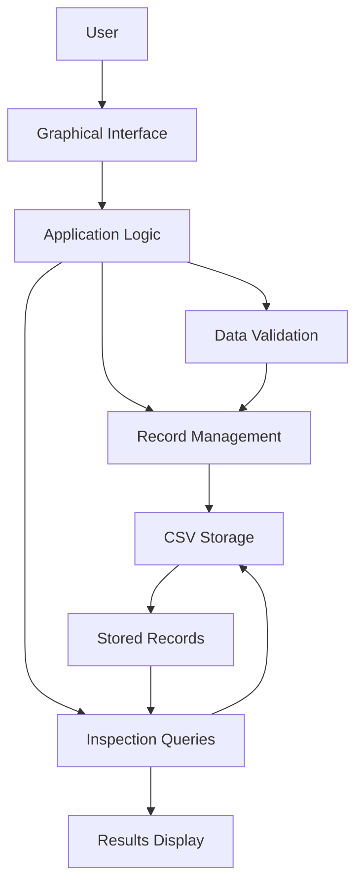
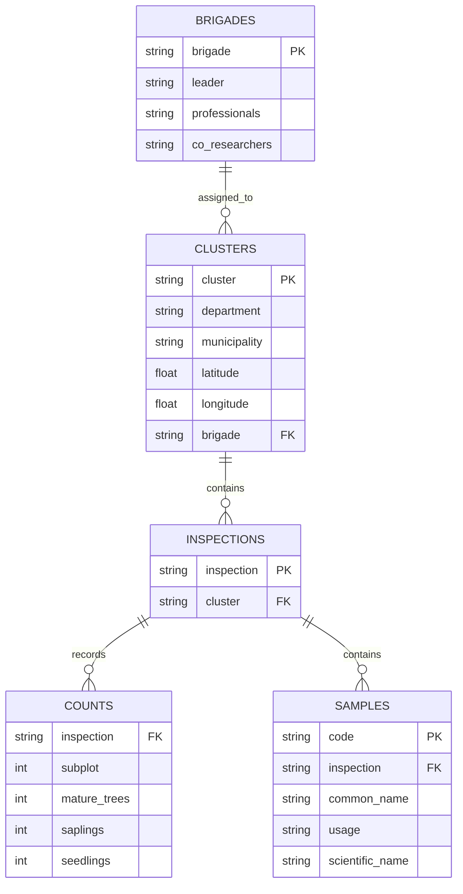
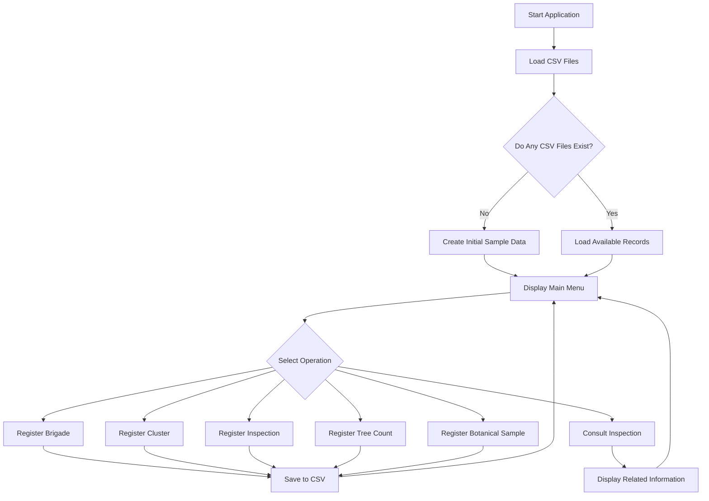

A Python-based application for registering, managing, and consulting forest inventory data. The system allows users to manage field teams, geographic clusters, inspections, tree counts, and botanical samples through an interactive interface.

Data is stored in CSV files, allowing records to persist between executions without requiring an external database.

## Table of Contents

- [Project Overview](#project-overview)
- [Features](#features)
- [Technologies](#technologies)
- [System Architecture](#system-architecture)
- [Data Model](#data-model)
- [Workflow](#workflow)
- [Installation and Execution](#installation-and-execution)
- [How to Use](#how-to-use)
- [Project Structure](#project-structure)
- [Data Validation](#data-validation)
- [Future Improvements](#future-improvements)
- [Project Scope](#project-scope)
- [Author](#author)

## Project Overview

The system organizes information collected during forest inventory activities.

Its data model connects field teams to geographic clusters, clusters to inspections, and inspections to tree counts and botanical samples. Users can register new records and retrieve the information associated with a selected inspection.

The graphical interface is built with `ipywidgets`, providing interactive buttons, text fields, numerical inputs, and dropdown menus.

### General Objective

To develop a tool for registering, organizing, and consulting forest inspection data, supporting the management of field teams, study locations, and collected information.

## Features

| Feature | Description |
|---|---|
| Field Team Registration | Stores team leaders, professionals, and local co-researchers. |
| Geographic Cluster Registration | Records departments, municipalities, geographic coordinates, and assigned teams. |
| Inspection Registration | Creates inspections associated with existing geographic clusters. |
| Tree Count Registration | Stores the number of mature trees, saplings, and seedlings recorded in each subplot. |
| Botanical Sample Registration | Records common names, usage categories, and scientific names. |
| Inspection Consultation | Retrieves the location, assigned team, tree counts, and botanical samples associated with an inspection. |
| Inspection List Refresh | Reloads available inspection records for consultation. |
| Persistent Data Storage | Saves information in CSV files. |
| Automatic Identifier Generation | Generates sequential identifiers for teams, clusters, inspections, and samples. |

## Technologies

- **Python:** Main programming language.
- **CSV:** Data storage format.
- **OS:** Checks whether storage files exist.
- **ipywidgets:** Builds the interactive interface.
- **IPython.display:** Displays interface components and updates the output area.

## System Architecture

The application is organized into three main layers: the user interface, application logic, and data storage.



### Main Components

**User Interface**

Provides menus, buttons, text fields, numerical inputs, and dropdown lists for interacting with the application.

**Application Logic**

Contains the functions responsible for registering records, generating identifiers, searching for existing data, and retrieving related inspection information.

**Data Storage**

Uses separate CSV files to store each type of record. The data is loaded into Python lists when the application starts and written back to the corresponding files when records are registered.

## Data Model

The application uses five CSV files connected through identifier fields.



The diagram represents the logical relationships used by the application. CSV files do not enforce primary-key or foreign-key constraints automatically; relationships are managed through the identifier values stored in each record.

### Data Files

| File | Stored Information |
|---|---|
| `brigadas.csv` | Team leaders, professionals, and local co-researchers. |
| `conglomerados.csv` | Geographic locations and assigned teams. |
| `inspecciones.csv` | Inspections and their associated clusters. |
| `conteos.csv` | Tree counts by subplot. |
| `muestras.csv` | Botanical samples and their usage categories. |

### Botanical Sample Categories

Each sample can be classified according to its intended use:

- **Medicinal:** Species used for medicinal purposes.
- **Alimenticio (Food):** Species used as food.
- **Maderable (Timber):** Species used for timber.

The scientific name may be left empty when identification is still pending.

## Workflow

The application follows a sequence of operations based on the relationships between records.



### Recommended Registration Sequence

1. Register a field team.
2. Register a geographic cluster and assign a team.
3. Register an inspection associated with the cluster.
4. Record tree counts for the inspection's subplots.
5. Register botanical samples associated with the inspection.
6. Consult the inspection to review its related information.

Following this sequence helps maintain consistency between related records.

## Installation and Execution

### Requirements

- Python 3.9 or later recommended.
- Jupyter Notebook or JupyterLab.
- The `ipywidgets` and `IPython` libraries.

### 1. Clone the Repository

```bash
git clone https://github.com/apabon42008-hub/PARCIAL-3---INVENTARIO-FORESTAL-NACIONAL.git
cd PARCIAL-3---INVENTARIO-FORESTAL-NACIONAL
```

### 2. Install Dependencies

```bash
pip install ipywidgets ipython
```

If Jupyter Notebook is not already installed:

```bash
pip install notebook
```

### 3. Run the Application

Start Jupyter Notebook:

```bash
jupyter notebook
```

Open the notebook containing the application code and execute the cell with the complete program.

**Note:** The application uses `ipywidgets` and `IPython.display`. It is designed to run in an interactive IPython/Jupyter environment rather than as a standalone desktop application.

### 4. Initial Data Setup

If none of the five CSV files exists, the application creates and saves a predefined sample dataset.

If at least one CSV file already exists, the application loads the available files without recreating the entire initial dataset.

For a complete demonstration dataset, run the application in a clean directory where none of the CSV files exists.

## How to Use

After execution, the interface displays six main operations:

| Operation | Description |
|---|---|
| Register Brigade | Enter the team leader, professionals, and local co-researchers. |
| Register Cluster | Enter the department, municipality, coordinates, and assigned team. |
| Register Inspection | Select an existing geographic cluster. |
| Register Tree Count | Select an inspection and enter the subplot and tree counts. |
| Register Sample | Select an inspection and enter the common name, usage category, and scientific name. |
| Consult Inspection | Display the location, assigned team, tree counts, and botanical samples associated with the selected inspection. |

### Example Inspection Output

When an inspection is selected, the application displays its associated information in organized sections.

```text
INSPECTION I001

CLUSTER C001
Location: Quibdo, Choco
Centroid: 5.6947 -76.6583

BRIGADE B001
Leader: Jair Sanchez
Professionals: Ana Rojas (botanist), Luis Mena (forest engineer)
Local co-researchers: Ever Blandon, Marta Palacios

TREE COUNTS
Subplot 1 | Mature trees: 12 | Saplings: 25 | Seedlings: 40
Subplot 2 | Mature trees: 9 | Saplings: 18 | Seedlings: 35

BOTANICAL SAMPLES
M001 | Cedar | Maderable | Cedrela odorata
M002 | Cat's claw | Medicinal | Uncaria tomentosa
```

This output is illustrative and based on the sample records included in the source code. The application displays the original stored values, which may use Spanish labels and names.

### Refreshing Inspections

The **Update Inspections** button reloads the inspection records from `inspecciones.csv` and refreshes the available options in the inspection dropdown.

This allows newly registered inspections to appear in the consultation interface without restarting the application.

## Project Structure

The following is a recommended repository structure:

```text
PARCIAL-3---INVENTARIO-FORESTAL-NACIONAL/
|
|-- README.md
|-- forest_inventory.ipynb
|
|-- brigadas.csv
|-- conglomerados.csv
|-- inspecciones.csv
|-- conteos.csv
|-- muestras.csv
```

The `forest_inventory.ipynb` filename is an example. Replace it with the actual notebook filename used in the repository.

The CSV files are generated automatically when needed. They do not have to be committed to GitHub if you prefer the application to initialize its sample dataset when run in a clean directory.

## Data Validation

The application implements basic checks to prevent incomplete operations and invalid numerical values.

- Requires a team leader's name when registering a brigade.
- Checks that the basic cluster information is provided and a brigade is selected.
- Requires a valid cluster selection when registering an inspection.
- Ensures that subplot numbers and tree counts are non-negative integers.
- Requires an inspection selection and a common name when registering a sample.
- Reports when an inspection or its related information cannot be found.
- Handles selected file access, input conversion, and missing-field errors.

These validations provide basic input control but do not replace comprehensive data integrity checks.

## Future Improvements

Potential enhancements for future versions include:

- Geographic validation for latitude and longitude.
- Duplicate identifier prevention and validation of record relationships.
- Editing and deleting existing records.
- PDF and Excel report generation.
- Statistical charts for forest inventory data.
- Map-based visualization of geographic clusters.
- More comprehensive validation of required fields and numerical inputs.
- Automated tests for the application's main functions.
- Migration from CSV storage to a relational database when needed.

## Project Scope

This project provides basic forest inventory data registration and consultation through an interactive Python interface.

It uses CSV files for persistent storage and does not require a dedicated database server or backend service.

The current implementation focuses on registration and consultation operations. Editing and deleting existing records, map visualization, report generation, and advanced database integrity enforcement are not currently implemented.

## Author

**Andres Felipe Pabon Barbosa**

Software Engineering Student

GitHub Repository: [PARCIAL-3---INVENTARIO-FORESTAL-NACIONAL](https://github.com/apabon42008-hub/PARCIAL-3---INVENTARIO-FORESTAL-NACIONAL)

## Keywords

Python, Forest Inventory, Forest Inspections, Biodiversity, CSV, ipywidgets, Data Management, Geographic Clusters, Botanical Sampling.
ing writing-block.md…]()
